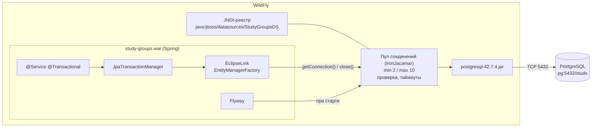
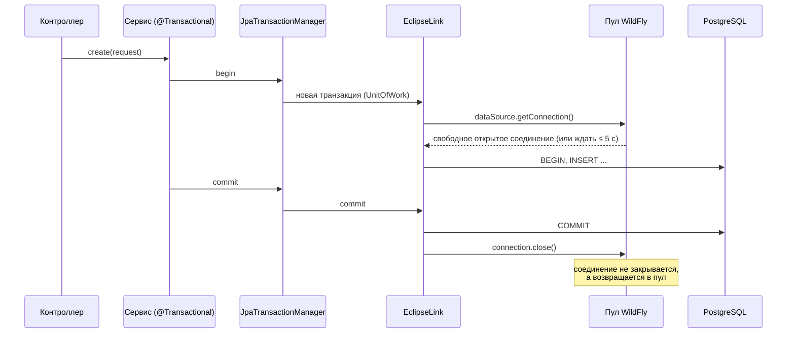

---
tags:
  - ИС
  - лаба
  - wildfly
  - jndi
  - деплой
aliases:
  - Деплой на WildFly
  - JNDI DataSource
---

# Запуск на сервере и подключение к БД

> [!summary] Коротко
> Приложение собирается в **`study-groups.war`** и разворачивается на **WildFly**. Адрес БД, логин, пароль и **пул соединений** настроены на сервере в объекте **DataSource**. Приложение знает только его **JNDI-имя** `java:jboss/datasources/StudyGroupsDS` и просит у сервера соединения по этому имени.

Связанные заметки: [[Конспект ИС Лаба 1]], [[Развёртывание на WildFly]]

---

## 1. Как запустить на сервере

### 1.0 Что понадобится

| Что | Где взять |
|---|---|
| **WildFly 27+** (Jakarta EE 10) | архив с wildfly.org, распаковать в домашний каталог на helios |
| Драйвер `postgresql-42.7.4.jar` | Maven Central или `~/.gradle/caches/.../org.postgresql/postgresql/42.7.4/` |
| `study-groups.war` | собрать локально (шаг 1.1) |

> [!warning] Версия WildFly
> Spring Boot 3 использует пакеты `jakarta.*`. WildFly **26 и старше** работает с `javax.*`, и приложение на нём не запустится.

### 1.1 Сборка (на своём компьютере)

```bash
cd frontend
npm install
npm run build
cd ..
./gradlew war
```

Результат: `build/libs/study-groups.war`. Что внутри:
- классы бэкенда и библиотеки (Spring, EclipseLink, Flyway);
- собранный фронтенд в `WEB-INF/classes/static`;
- `WEB-INF/jboss-web.xml` — публикует приложение в корне `/`;
- `WEB-INF/jboss-deployment-structure.xml` — отключает JPA-подсистему WildFly;
- **нет** встроенного Tomcat и **нет** драйвера PostgreSQL: их даёт сервер.

### 1.2 Загрузка на helios

```bash
scp -P 2222 build/libs/study-groups.war sXXXXXX@se.ifmo.ru:~/
scp -P 2222 postgresql-42.7.4.jar sXXXXXX@se.ifmo.ru:~/
ssh -p 2222 sXXXXXX@se.ifmo.ru
```

### 1.3 Запуск WildFly

Порты `8080` (HTTP) и `9990` (управление) на helios почти наверняка заняты, поэтому берём **смещение портов** `N`, например последние цифры ИСУ:

```bash
cd ~/wildfly-<версия>
./bin/standalone.sh -Djboss.socket.binding.port-offset=N > ~/wildfly.log 2>&1 &
```

- HTTP: `8080 + N`
- консоль управления: `9990 + N`

Проверить, что сервер поднялся:
```bash
tail -f ~/wildfly.log    # ждём строку "WFLYSRV0025: WildFly ... started"
```

### 1.4 Драйвер и DataSource (один раз)

Подключаемся к консоли управления:
```bash
./bin/jboss-cli.sh --connect --controller=localhost:$((9990 + N))
```

**Драйвер.** Деплоим как обычное приложение, WildFly сам найдёт в нём `java.sql.Driver`:
```
deploy ~/postgresql-42.7.4.jar
```

**DataSource** с пулом соединений:
```
data-source add --name=StudyGroupsDS \
  --jndi-name=java:jboss/datasources/StudyGroupsDS \
  --driver-name=postgresql-42.7.4.jar \
  --connection-url=jdbc:postgresql://pg:5432/studs \
  --user-name=sXXXXXX \
  --password=******** \
  --jta=false \
  --min-pool-size=2 \
  --max-pool-size=10 \
  --pool-prefill=true \
  --idle-timeout-minutes=5 \
  --blocking-timeout-wait-millis=5000 \
  --validate-on-match=true \
  --background-validation=false \
  --valid-connection-checker-class-name=org.jboss.jca.adapters.jdbc.extensions.postgres.PostgreSQLValidConnectionChecker \
  --exception-sorter-class-name=org.jboss.jca.adapters.jdbc.extensions.postgres.PostgreSQLExceptionSorter
```

**Проверка соединения:**
```
/subsystem=datasources/data-source=StudyGroupsDS:test-connection-in-pool
```
Ответ `"outcome" => "success"` означает, что сервер достучался до `pg:5432/studs`.

Настройки сохраняются в `standalone/configuration/standalone.xml` и переживают перезапуск сервера.

### 1.5 Развёртывание приложения

```
deploy ~/study-groups.war
```

В `~/wildfly.log` должны появиться:
- `Started StudyGroupsApplication` — Spring поднялся;
- строки Flyway `Migrating schema ...` или `Schema ... is up to date`;
- `WFLYSRV0010: Deployed "study-groups.war"`.

### 1.6 Открыть в браузере

С ноутбука пробрасываем порт:
```bash
ssh -p 2222 -L 8080:localhost:<8080+N> sXXXXXX@se.ifmo.ru
```
Затем открываем `http://localhost:8080/`.

### 1.7 Повседневные команды

| Задача | Команда (в `jboss-cli`) |
|---|---|
| Обновить приложение | `deploy ~/study-groups.war --force` |
| Удалить приложение | `undeploy study-groups.war` |
| Список развёрнутого | `deployment-info` |
| Изменить лимит пула | `/subsystem=datasources/data-source=StudyGroupsDS:write-attribute(name=max-pool-size,value=20)` |
| Включить статистику пула | `/subsystem=datasources/data-source=StudyGroupsDS:write-attribute(name=statistics-enabled,value=true)` |
| Посмотреть статистику | `/subsystem=datasources/data-source=StudyGroupsDS/statistics=pool:read-resource(include-runtime=true)` |
| Остановить сервер | `shutdown` |

> [!tip] Пароль не в открытом виде
> Пароль можно положить в хранилище Elytron (`credential-store`) и подключить к DataSource через `--credential-reference` вместо `--password`.

### 1.8 Частые проблемы

| Симптом | Причина / решение |
|---|---|
| `Address already in use` | порт занят, увеличь `port-offset` |
| `NameNotFoundException: StudyGroupsDS` | DataSource не создан или имя JNDI не совпадает |
| `WFLYJPA0033` / ищет `persistence.xml` | в war нет `jboss-deployment-structure.xml` |
| `ClassNotFoundException: jakarta.servlet...` | WildFly старше 27 |
| Flyway: `non-empty schema ... no schema history` | уже решено: `baseline-on-migrate: true` в `application.yml` |
| Страница открывается, а API выдаёт 404 | приложение опубликовано не в корне, проверь `jboss-web.xml` |
| `Превзойдена дисковая квота`, `Could not create standalone_xml_history`, сервер завершается | кончилось место в домашнем каталоге: `quota -s`, `du -sh ~/* ~/.[!.]* \| sort -h`, удалить лишнее (см. ниже) |
| `jboss.jdbc-driver.postgresql (missing)` | в DataSource указан драйвер `postgresql`, а задеплоенный jar называется `postgresql-42.7.4.jar`: `/subsystem=datasources/data-source=StudyGroupsDS:write-attribute(name=driver-name,value=postgresql-42.7.4.jar)` |
| `java:jboss/datasources/ExampleDS (missing) ... DefaultDataSource` | ExampleDS удалён, а подсистема `ee` ссылается на него как на источник по умолчанию: `/subsystem=ee/service=default-bindings:write-attribute(name=datasource,value=java:jboss/datasources/StudyGroupsDS)` |
| в `deployments/` лежит `study-groups-boot.war` | это вариант для `java -jar` со встроенным Tomcat — на сервер не кладётся, только `study-groups.war` |

> [!warning] Место на helios
> WildFly хранит копию каждого развёрнутого war в `standalone/data/content`, плюс `standalone/tmp` и логи. При квоте в несколько сотен МБ два war по ~40 МБ, архив WildFly, `~/.gradle`, `node_modules` быстро её съедают. Перед повторным запуском (сервер остановлен) можно удалить `standalone/tmp/*`, `standalone/log/*`, ненужные war и архивы.

### 1.9 Локально, без сервера

```bash
./gradlew bootTestRun
```
Запускает встроенный PostgreSQL, приложение работает в профиле `dev`, JNDI не используется. Фронтенд: `cd frontend && npm run dev`.

---

## 2. Как работает подключение к БД

### 2.1 Общая схема



### 2.2 Что такое DataSource, JNDI и пул

- **DataSource** — стандартный интерфейс Java (`javax.sql.DataSource`) с методом `getConnection()`. Код приложения не знает, откуда берутся соединения.
- **JNDI** (Java Naming and Directory Interface) — реестр объектов сервера по именам. WildFly регистрирует там DataSource под именем `java:jboss/datasources/StudyGroupsDS`.
- **Пул соединений.** Открывать TCP-соединение к PostgreSQL с авторизацией на каждый запрос дорого. Сервер держит несколько **уже открытых** соединений и выдаёт их по запросу. Когда приложение вызывает `connection.close()`, соединение не закрывается, а **возвращается в пул**. На WildFly пулом управляет подсистема JCA (IronJacamar).

> [!note] Зачем так делать (то, что хотел преподаватель)
> - **В приложении нет секретов.** Адрес, логин и пароль хранятся только на сервере.
> - **Ограничение подключений** на стороне сервера: `max-pool-size` — это максимум одновременных соединений к БД. Сколько бы пользователей ни пришло, больше соединений не откроется: лишние запросы ждут `blocking-timeout-wait-millis`.
> - **Соединения держатся открытыми** (`min-pool-size`, `pool-prefill`) и переиспользуются, а простаивающие закрываются (`idle-timeout-minutes`).
> - **Контроль здоровья:** соединение проверяется перед выдачей (`validate-on-match`), сломанные выбрасываются из пула (`exception-sorter`).
> - **Администрирование без пересборки:** поменять БД или лимиты можно через `jboss-cli`, приложение не трогаем.

### 2.3 Как приложение находит DataSource

[application.yml](../src/main/resources/application.yml):
```yaml
spring:
  profiles:
    default: server          # если профиль не задан явно — server
---
spring:
  config.activate.on-profile: server
  datasource:
    jndi-name: ${DATASOURCE_JNDI:java:jboss/datasources/StudyGroupsDS}
```

Что происходит при старте:
1. WildFly разворачивает war, видит `SpringBootServletInitializer` (его наследует `StudyGroupsApplication`) и запускает Spring.
2. Активен профиль `server`, значит задано свойство `spring.datasource.jndi-name`.
3. Срабатывает автоконфигурация Spring Boot **`JndiDataSourceAutoConfiguration`**. Через `JndiDataSourceLookup` она делает `new InitialContext().lookup("java:jboss/datasources/StudyGroupsDS")` и регистрирует найденный объект как бин `DataSource`.
4. Обычная `DataSourceAutoConfiguration` с HikariCP и url **не срабатывает**, потому что бин `DataSource` уже есть.
5. Этот единственный `DataSource` получают:
   - **Flyway**: сразу применяет миграции (`V1`, `V3`, `R__special_operations`);
   - **`JpaConfig.entityManagerFactory(DataSource ...)`**: передаёт его в EclipseLink как non-JTA DataSource.

| Профиль | Откуда DataSource | Где используется |
|---|---|---|
| `server` (по умолчанию) | JNDI сервера приложений | WildFly / Tomcat |
| `dev` | `spring.datasource.url` встроенной БД | `./gradlew bootTestRun` (`DevServer`) |
| `test` | url из `@DynamicPropertySource` | интеграционные тесты |

### 2.4 Жизнь одного соединения (запрос пользователя)



- Соединение занято **только на время транзакции**: один HTTP-запрос — одна транзакция сервиса.
- Если все `max-pool-size` соединений заняты, следующий запрос **ждёт** до `blocking-timeout-wait-millis`, затем получает ошибку. БД не перегружается.

### 2.5 Почему `jta=false`

Есть два способа управлять транзакциями:
- **JTA** — транзакциями управляет сервер приложений (менеджер транзакций WildFly);
- **resource-local** — транзакциями управляет само приложение через JDBC.

У нас транзакциями управляет **Spring** (`JpaTransactionManager`, `@Transactional`), а EclipseLink получает DataSource как non-JTA. Поэтому DataSource на сервере создаётся с `jta=false`. Иначе соединения ждали бы включения в JTA-транзакцию сервера, которой у нас нет.

### 2.6 Драйвер и загрузчики классов

- **Чей драйвер.** Драйвер PostgreSQL принадлежит **серверу** (задеплоен отдельно), в `study-groups.war` его нет: в `build.gradle` у задачи `war` стоит фильтр `!it.name.startsWith('postgresql-')`.
- **Классы драйвера приложению не видны.** Поэтому `GlobalExceptionHandler` ищет в цепочке причин стандартный `java.sql.SQLException`, а не `PSQLException`. Имя нарушенного ограничения и текст ошибки он достаёт **рефлексией**: `getServerErrorMessage().getConstraint()`. Код ошибки (`SQLState`: `23514`, `23503`, `P0002`…) берётся стандартным `getSQLState()`.

### 2.7 Зачем `jboss-deployment-structure.xml`

WildFly — полноценный Jakarta EE сервер со своей JPA-подсистемой (Hibernate). Увидев в классах `@PersistenceContext`, она пытается сама создать `EntityManager` из `persistence.xml`, которого у нас нет. В итоге развёртывание падает. Файл отключает эту подсистему (`<exclude-subsystems><subsystem name="jpa"/>`), и JPA целиком поднимает Spring с EclipseLink из war.

### 2.8 Вариант с Tomcat

Если нужен Tomcat 10.1+, приложение то же, меняется только серверная настройка в `conf/context.xml`:
```xml
<Resource name="jdbc/StudyGroupsDS" auth="Container" type="javax.sql.DataSource"
          driverClassName="org.postgresql.Driver" url="jdbc:postgresql://pg:5432/studs"
          username="sXXXXXX" password="********"
          maxTotal="10" maxIdle="5" minIdle="2" maxWaitMillis="5000"
          validationQuery="SELECT 1" testOnBorrow="true"/>
```
Дальше:
- драйвер положить в `tomcat/lib/`;
- war переименовать в `ROOT.war`, чтобы приложение было в корне;
- задать JNDI-имя при запуске: `-DDATASOURCE_JNDI=java:comp/env/jdbc/StudyGroupsDS`.

---

## 3. Что сказать на защите

> [!question] «Как приложение подключается к БД?»
> Через **DataSource сервера приложений по JNDI**. В конфиге приложения нет ни адреса, ни учётных данных, только JNDI-имя `java:jboss/datasources/StudyGroupsDS`. Spring Boot (`JndiDataSourceAutoConfiguration`) находит DataSource в реестре JNDI и передаёт его Flyway и EclipseLink.

> [!question] «Где ограничиваются подключения?»
> В пуле соединений WildFly: `max-pool-size` (максимум одновременных соединений), `min-pool-size` (сколько держать открытыми), `blocking-timeout-wait-millis` (сколько ждать свободное), `idle-timeout-minutes` (когда закрывать простаивающие). Меняется через `jboss-cli` без пересборки приложения.

> [!question] «Что происходит с соединением после запроса?»
> `connection.close()` возвращает соединение в пул, а не закрывает его. Оно занято только на время транзакции сервиса.

> [!question] «Кто управляет транзакциями?»
> Spring (`JpaTransactionManager`, `@Transactional`), поэтому у DataSource стоит `jta=false`.
