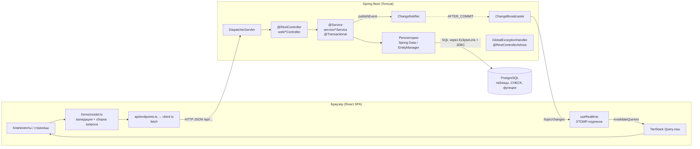
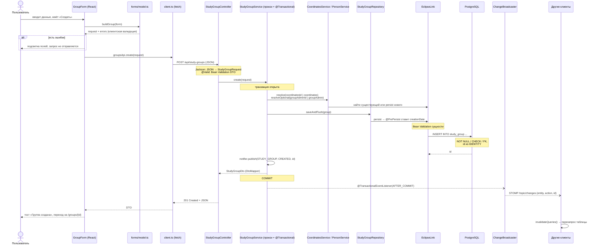
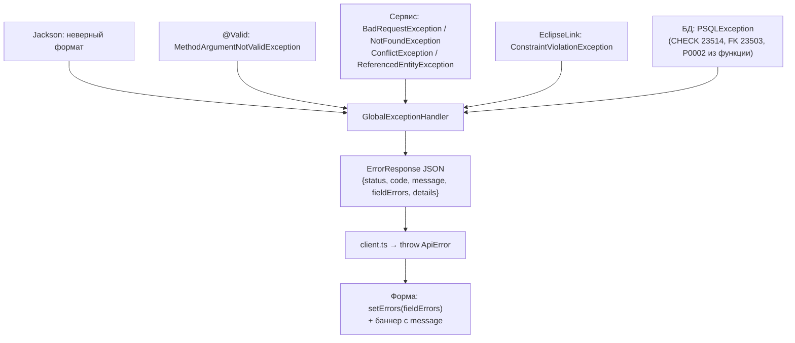
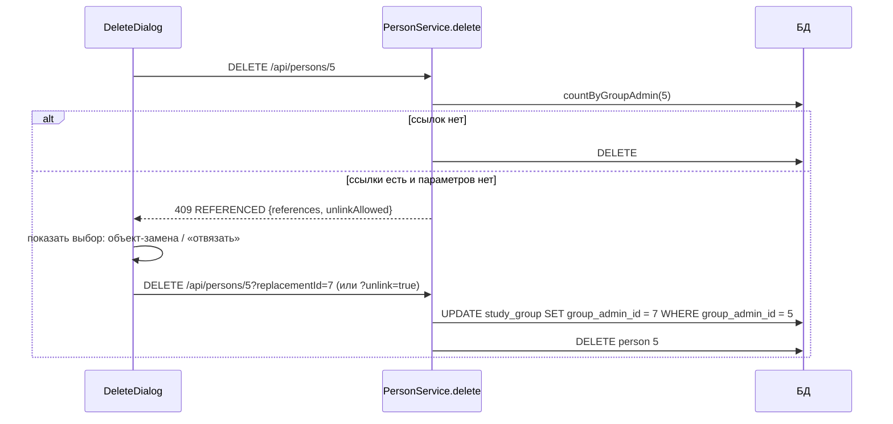

---
tags:
  - ИС
  - лаба
  - spring
  - jpa
  - react
aliases:
  - StudyGroup IS
  - ИС Лаба 1
---

# ИС Лаба 1 — StudyGroup

> [!summary] Коротко
> SPA на **React** общается с бэкендом на **Spring MVC** по REST (JSON). Бэкенд разбит на слои: контроллеры → сервисы → репозитории → **JPA/EclipseLink** → **PostgreSQL**. Схему и функции БД создаёт **Flyway**. Об изменениях всех клиентов оповещает **WebSocket (STOMP)**: после коммита сервер рассылает событие, клиенты перезапрашивают данные.

**Стек:** Java 17 · Spring Boot 3.3 (Spring MVC, Spring Data JPA, WebSocket, Validation) · EclipseLink 4 · PostgreSQL · Flyway · React 18 + TypeScript + Vite · TanStack Query · @stomp/stompjs

---

## 1. Как работает приложение

### 1.1 Общая схема



### 1.2 Что такое бин и какие бины есть

**Бин** — объект, который создаёт и хранит Spring (IoC-контейнер) и сам внедряет туда, где он нужен (через конструктор). Бинами становятся классы с аннотациями:

| Аннотация | Классы |
|---|---|
| `@RestController` | `StudyGroupController`, `PersonController`, `CoordinatesController`, `LocationController`, `SpecialOperationsController` |
| `@RestControllerAdvice` | `GlobalExceptionHandler` |
| `@Service` | `StudyGroupService`, `PersonService`, `CoordinatesService`, `LocationService`, `SpecialOperationsService` |
| `@Component` | `ChangeNotifier`, `ChangeBroadcaster` |
| `@Repository` | `StudyGroupSearchRepository`, `SpecialOperationsRepository` |
| интерфейсы `JpaRepository` | `StudyGroupRepository`, `PersonRepository`, `CoordinatesRepository`, `LocationRepository` (реализацию генерирует Spring Data) |
| `@Configuration` + `@Bean` | `JpaConfig` → `entityManagerFactory`, `transactionManager`; `WebSocketConfig`; `SpaConfig` |

> [!note] Прокси
> Сервисы с `@Transactional` оборачиваются в **прокси**. Контроллер вызывает прокси, прокси открывает транзакцию, вызывает настоящий метод, затем делает commit, а при исключении — rollback.

### 1.3 Запуск приложения

1. `StudyGroupsApplication.main` → `SpringApplication.run` → поднимаются Tomcat и контекст Spring.
2. Создаётся `DataSource` (HikariCP) по `spring.datasource.*` из `application.yml`. Профиль `helios` задаёт `pg:5432/studs`.
3. **Flyway** выполняет миграции `V1__schema.sql` (таблицы, ограничения), `V3__allow_zero_after_expel.sql` и повторяемую `R__special_operations.sql` (функции). Версии хранятся в таблице `flyway_schema_history`: V-миграции выполняются один раз, R-миграция — заново при изменении файла. Перед этим `FlywayConfig` делает `repair()`.
4. `JpaConfig.entityManagerFactory` создаёт EclipseLink (сканирует `ru.itmo.lab1.domain`). Spring сам гарантирует, что это происходит **после** Flyway.
5. Spring Data генерирует реализации репозиториев, создаются сервисы и контроллеры.
6. `WebSocketConfig` регистрирует endpoint `/ws` и брокер `/topic`.
7. `SpaConfig` отдаёт `index.html` и JS/CSS из `static/` (собранный фронтенд лежит внутри jar).

### 1.4 Путь запроса: создание группы (главный сценарий)



**Шаги подробнее:**

1. **Ввод.** `GroupForm.tsx` хранит состояние формы в `useState<GroupForm>`. Все поля — **строки**, как в `<input>`.
2. **Клиентская валидация.** `buildGroup(form)` в `forms/model.ts` разбирает числа (`readNumber`: целое или дробное, диапазон int/long/float, `> 0`), проверяет обязательные поля и собирает `StudyGroupRequest`. Ошибки кладутся в объект с ключами вида `"groupAdmin.location.name"`: они совпадают с ключами ошибок сервера.
3. **Отправка.** `groupsApi.create` → `request('POST', '/api/study-groups', body)` → `fetch` с `JSON.stringify`.
   - В разработке запрос проксирует **Vite** (`vite.config.ts` → `127.0.0.1:8080`).
   - В продакшене фронтенд и API находятся на одном сервере Spring.
4. **Приём в Spring.** Tomcat → `DispatcherServlet` находит метод по `@PostMapping`. **Jackson** десериализует JSON в record `StudyGroupRequest`. Неверный тип (например, `"abc"` в число или несуществующее значение enum) даёт `HttpMessageNotReadableException` → 400.
5. **`@Valid`.** Bean Validation проверяет аннотации DTO (`@NotBlank`, `@NotNull`, `@Positive`, вложенные `@Valid`). Нарушение даёт `MethodArgumentNotValidException` → 400 с `fieldErrors`.
6. **Контроллер** ничего не решает, только вызывает `service.create(request)`.
7. **Сервис** (в транзакции):
   - `coordinatesService.resolve(...)`: либо **существующие** координаты по `coordinatesId`, либо создание новых. Должно быть ровно одно из двух.
   - `personService.resolveOptional(...)`: существующий человек, новый или никакой. Внутри так же разрешается его `Location`.
   - Заполняет сущность `StudyGroup` и вызывает `repository.saveAndFlush`.
8. **EclipseLink:** `persist` → срабатывает `@PrePersist onCreate()` (ставит `creationDate`) → Bean Validation сущности (режим `CALLBACK`) → `INSERT` → `id` возвращает БД (`GENERATED ALWAYS AS IDENTITY`).
9. **PostgreSQL** ещё раз проверяет `NOT NULL`/`CHECK`/`FK`. Это последний рубеж защиты.
10. **Событие.** `ChangeNotifier.publish(...)` публикует `EntityChangedEvent`. Оно **ждёт коммита**.
11. **Ответ.** `DtoMapper.toDto(group)` → JSON → `201 Created`.
12. **Коммит → рассылка.** `ChangeBroadcaster.onChange` (`AFTER_COMMIT`) → `SimpMessagingTemplate.convertAndSend("/topic/changes", event)`.
13. **Другие клиенты.** `useRealtime` получает сообщение → `queryClient.invalidateQueries()` → все активные запросы (таблица с текущими фильтрами, карточка, списки) перезапрашиваются.

### 1.5 Путь ошибки



- Ключи `fieldErrors` совпадают с ключами клиентской валидации, поэтому ошибки сервера показываются под **теми же** полями.
- Транзакция при исключении откатывается, событие не рассылается.

### 1.6 Таблица: пагинация, фильтр, сортировка

`GroupsPage` → `GET /api/study-groups?page&size&sort&direction&filterField&filterValue`

1. `StudyGroupService.search`:
   - по строке находит колонку в **белом списке** `StudyGroupColumn` (неизвестная → 400, защита от инъекций);
   - ограничивает размер страницы (1..100).
2. `StudyGroupSearchRepository.search` строит запрос через **Criteria API**:
   - `StudyGroupJoins.of(root)`: `INNER JOIN coordinates`, `LEFT JOIN groupAdmin`, `LEFT JOIN location`. LEFT нужен, чтобы группы без администратора не пропадали.
   - Фильтр по строке: `lower(поле) LIKE '%значение%'` с экранированием `%` и `_` (**неполное совпадение**).
   - Фильтр по enum: подходящие константы подбираются в Java, затем `IN (...)`.
   - Сортировка по выбранной колонке, затем по `id`, чтобы порядок между страницами был стабильным.
   - Отдельный `count`-запрос для `totalElements`.
3. Ответ: `PageResponse {content, page, size, totalElements, totalPages}`.
4. Фронт: фильтр применяется с задержкой 300 мс, сортировка — по клику на заголовок. `keepPreviousData` убирает мигание таблицы.

### 1.7 Удаление со связанными объектами

Группа удаляется просто: на неё никто не ссылается, а связанные объекты остаются в системе.

Для `Person` / `Coordinates` / `Location`:



- `Coordinates` отвязать нельзя: поле обязательное (`unlinkAllowed=false`), поэтому нужна замена.
- `Person` и `Location` можно заменить или отвязать (выставить null).
- Всё происходит в одной транзакции: если удаление упадёт, перепривязка откатится.

### 1.8 Специальные операции

`SpecialPage` → `SpecialOperationsController` → `SpecialOperationsService` → `SpecialOperationsRepository` → **функции PostgreSQL** через `em.createNativeQuery("SELECT ... FROM sg_...()")`.

Функции возвращают id (или число), сами объекты затем загружаются через JPA, чтобы маппинг сущности был в одном месте.

### 1.9 Одновременное редактирование (оптимистическая блокировка)

- У всех сущностей есть поле `@Version version`.
- Клиент отправляет версию, которую видел. `ServiceUtils.checkVersion` сравнивает её с текущей: не совпадает → `ConflictException` → **409**.
- EclipseLink дополнительно делает `UPDATE ... WHERE version = ?`, что защищает от гонки между чтением и записью.
- `EditGroupDialog`: если по WebSocket пришло изменение и версия в БД стала другой, показывается предупреждение «изменена другим пользователем» с кнопкой «Загрузить актуальные данные».

---

## 2. Классы и их ответственность

### 2.1 Бэкенд (`ru.itmo.lab1`)

#### `config` — настройка инфраструктуры

| Класс | За что отвечает | Главное |
|---|---|---|
| `StudyGroupsApplication` | Точка входа | `main` → `SpringApplication.run` |
| `JpaConfig` | Подключает **EclipseLink** вместо Hibernate | `entityManagerFactory()`: vendor adapter, `weaving=false`, `ddl-generation=none` (схема за Flyway), `cache.shared=false`, `validation-mode=CALLBACK`; `transactionManager()` → `JpaTransactionManager` |
| `WebSocketConfig` | STOMP поверх WebSocket | `registerStompEndpoints` → `/ws`; `configureMessageBroker` → простой брокер `/topic`; константа `CHANGES_TOPIC` |
| `SpaConfig` | Раздача React из jar | неизвестный путь (не `/api`) → `index.html`, чтобы работали маршруты React Router после F5 |

#### `domain` — сущности JPA (таблицы)

| Класс | Таблица | Особенности |
|---|---|---|
| `StudyGroup` | `study_group` | `@Id @GeneratedValue(IDENTITY)`; `@ManyToOne coordinates` (обязательно), `@ManyToOne groupAdmin` (может быть null); `@PrePersist onCreate()` ставит `creationDate`; `@Version` |
| `Coordinates` | `coordinates` | `x: Float @NotNull`, `y: double` |
| `Person` | `person` | `@ManyToOne location`, enum-поля `@Enumerated(STRING)`, `weight @Positive` |
| `Location` | `location` | `name @NotNull` |
| `Color`, `Country`, `FormOfEducation`, `Semester` | — | перечисления, в БД хранятся строками + `CHECK IN (...)` |
| `ZonedDateTimeConverter` | — | `AttributeConverter<ZonedDateTime, Timestamp>`: JPA не умеет `ZonedDateTime` |

> [!tip] Почему вспомогательные классы — отдельные сущности, а не `@Embeddable`
> Иначе нельзя **выбрать уже существующий** объект при создании и **перепривязать** ссылки при удалении. Оба требования есть в задании.

#### `dto` — объекты API

| Класс | Назначение |
|---|---|
| `StudyGroupRequest` | Вход для create/update. **Нет** `id` и `creationDate`. Координаты: `coordinatesId` **или** `coordinates`; админ: `groupAdminId` **или** `groupAdmin`; `version` для блокировки |
| `PersonRequest`, `CoordinatesRequest`, `LocationRequest` | То же для вспомогательных объектов (аннотации валидации) |
| `StudyGroupDto`, `PersonDto`, `CoordinatesDto`, `LocationDto` | Ответы; вложенные объекты включены, т.е. «информация о связанных объектах» |
| `PageResponse<T>` | Страница таблицы |
| `ErrorResponse` | Единый формат ошибки |
| `EntityChangedEvent` | Событие `{entity, action, id}` для WebSocket |
| `IdCountDto` | Результат «группировки по id» |

#### `mapper`

| Класс | Методы |
|---|---|
| `DtoMapper` | `toDto(StudyGroup / Person / Coordinates / Location)`: сущность → DTO. Сущности наружу не отдаются (нет циклов, ленивых прокси, лишних полей) |

#### `repository` — доступ к данным

| Класс | Методы |
|---|---|
| `StudyGroupRepository` (Spring Data) | CRUD; `countByCoordinates`, `countByGroupAdmin`; JPQL bulk-update `reassignCoordinates`, `reassignGroupAdmin`, `unlinkGroupAdmin` |
| `PersonRepository` | `findAllByOrderByIdAsc`, `countByLocation`, `reassignLocation`, `unlinkLocation` |
| `CoordinatesRepository`, `LocationRepository` | `findAllByOrderByIdAsc` + CRUD |
| `StudyGroupSearchRepository` | `search(filterColumn, filterValue, sortColumn, asc, page, size)`: Criteria API, `buildFilter`, `buildOrder`, `escapeLike` |
| `StudyGroupColumn` (enum) | Белый список колонок: ключ с клиента → путь в Criteria; `byKey`, `isFilterable`, `path(joins)` |
| `StudyGroupJoins` (record) | Нужные join'ы (`INNER coordinates`, `LEFT admin`, `LEFT location`) |
| `SpecialOperationsRepository` | Вызов функций БД: `findMinExpelledId`, `countById`, `findIdsWithAdminGreaterThan`, `expelAll`, `addStudent` |

#### `service` — бизнес-логика (`@Transactional`)

| Класс | Методы |
|---|---|
| `StudyGroupService` | `search`, `get`, `create`, `update` (с `checkVersion`), `delete`; приватный `apply(group, request)` переносит поля и разрешает связи |
| `CoordinatesService` | `findAll`, `get`, `create`, `update`, `delete(id, replacementId)`; `resolve(existingId, newCoords)` для формы группы |
| `PersonService` | то же + `delete(id, replacementId, unlink)`; `resolveOptional(existingId, newPerson)` |
| `LocationService` | то же + `resolveOptional(existingId, newLocation, fieldPrefix)` |
| `SpecialOperationsService` | `minExpelled`, `countById`, `adminGreaterThan`, `expelAll`, `addStudent` |
| `ChangeNotifier` | `publish(entity, action, id)` → `ApplicationEventPublisher`. Сервисы **не знают** про WebSocket |
| `ServiceUtils` | `checkVersion`, `trimToNull`, `checkReplacement`, `prefixed` |

#### `web` — REST

| Класс | Эндпоинты |
|---|---|
| `StudyGroupController` | `GET /api/study-groups` (страница), `GET /{id}`, `POST`, `PUT /{id}`, `DELETE /{id}` |
| `PersonController` | `/api/persons`: CRUD; `DELETE /{id}?replacementId=&unlink=` |
| `CoordinatesController` | `/api/coordinates`: CRUD; `DELETE /{id}?replacementId=` |
| `LocationController` | `/api/locations`: CRUD; `DELETE /{id}?replacementId=&unlink=` |
| `SpecialOperationsController` | `GET /api/special/min-expelled`, `GET /count-by-id`, `GET /admin-greater-than?personId=`, `POST /groups/{id}/expel-all`, `POST /groups/{id}/add-student` |
| `GlobalExceptionHandler` | Все исключения → `ErrorResponse`; разбирает `SQLState` PostgreSQL (`23514` CHECK, `23503` FK, `P0002` «не найдено» из функции, `22003` переполнение) |

#### `realtime`

| Класс | Методы |
|---|---|
| `ChangeBroadcaster` | `onChange(event)` с `@TransactionalEventListener(AFTER_COMMIT)` → `SimpMessagingTemplate.convertAndSend("/topic/changes", event)` |

#### `exception`

`NotFoundException` (404), `BadRequestException` (400 + fieldErrors), `ConflictException` (409), `ReferencedEntityException` (409 `REFERENCED` + `references`, `unlinkAllowed`).

### 2.2 База данных (`src/main/resources/db/migration`)

| Файл | Содержимое |
|---|---|
| `V1__schema.sql` | 4 таблицы; `id BIGINT GENERATED ALWAYS AS IDENTITY`; `NOT NULL`; именованные `CHECK` (`> 0`, `btrim(name) <> ''`, значения enum); FK; индексы по FK |
| `V3__allow_zero_after_expel.sql` | `students_count >= 0`, `transferred_students >= 0` |
| `R__special_operations.sql` | повторяемая миграция: `sg_min_expelled()`, `sg_count_by_id()`, `sg_admin_greater_than(person_id)`, `sg_expel_all(group_id)`, `sg_add_student(group_id)`; перевыполняется при каждом изменении файла |

> [!info] Flyway и правка SQL
> `FlywayConfig` перед `migrate()` вызывает `repair()`: контрольные суммы применённых миграций подгоняются под файлы, удалённые миграции помечаются удалёнными. Правка старого `V`-файла больше не ломает запуск, но и **не применяется** — изменения схемы кладутся в новый `V<N>__*.sql`.

### 2.3 Фронтенд (`frontend/src`)

| Файл | За что отвечает |
|---|---|
| `main.tsx` | Корень: `QueryClientProvider`, `BrowserRouter`, `ToastProvider` |
| `App.tsx` | **Меню** (`NavLink`) + маршруты (`Routes`); вызывает `useRealtime()`, индикатор «онлайн» |
| `api/types.ts` | TS-типы DTO и перечислений, русские подписи `label()` |
| `api/client.ts` | `request()` — обёртка над `fetch`; класс `ApiError` (status, code, fieldErrors, details) |
| `api/endpoints.ts` | `groupsApi`, `personsApi`, `coordinatesApi`, `locationsApi`, `specialApi`, `queryKeys` |
| `forms/model.ts` | Типы состояния форм; `emptyGroup`, `groupToForm`…; `readNumber`; **`buildGroup` / `buildPerson` / `buildCoordinates` / `buildLocation`** — валидация + сборка запроса |
| `realtime/useRealtime.ts` | STOMP-клиент, подписка на `/topic/changes`, `invalidateQueries`, автопереподключение |
| `components/ui.tsx` | `Field`, `TextInput`, `EnumSelect`, `Modal`, `ErrorBanner`, тосты |
| `components/EntityFields.tsx` | Поля Coordinates/Location/Person; `RefModeSwitch` («существующий / новый / не задан»); `ExistingSelect`; хуки списков |
| `components/GroupForm.tsx` | Общая форма группы (создание и редактирование) |
| `components/EditGroupDialog.tsx` | **Отдельное окно** редактирования; отслеживает изменение/удаление другим пользователем |
| `components/GroupDetails.tsx` | Карточка группы со связанными объектами |
| `components/DeleteDialog.tsx` | Удаление с выбором замены (`DeleteDialog`), подтверждение (`ConfirmDialog`) |
| `components/EditorModal.tsx` | Модалка создания/редактирования вспомогательных объектов |
| `pages/GroupsPage.tsx` | Главная таблица: колонки, пагинация, сортировка, фильтр |
| `pages/GroupCreatePage.tsx` | Создание группы |
| `pages/GroupViewPage.tsx` | Поиск по ID, карточка, переход к редактированию |
| `pages/PersonsPage.tsx`, `CoordinatesPage.tsx`, `LocationsPage.tsx` | Справочники вспомогательных объектов |
| `pages/SpecialPage.tsx` | Отдельный интерфейс спецопераций |

---

## 3. Что рассказать на защите

### 3.1 Требование → как сделано

| Требование | Реализация |
|---|---|
| CRUD в отдельных окнах | Страницы «Создать группу», «Поиск по ID»; модальные окна редактирования и удаления |
| При просмотре показывать связанные объекты | `StudyGroupDto` содержит `coordinates`, `groupAdmin` → `location`; `GroupDetails` рисует их карточками |
| При создании связать с существующими | Переключатель «Выбрать существующий / Создать новый» → `coordinatesId` / `groupAdminId` / `locationId` |
| Операции на сервере, синхронизация с БД | Вся логика в `@Service` в транзакциях; клиент только отправляет запросы |
| Таблица, каждый атрибут — колонка, пагинация | `GroupsPage` + серверная пагинация (`setFirstResult` / `setMaxResults`) |
| Фильтр/сортировка по неполному совпадению | Criteria API, `LIKE '%…%'` без учёта регистра, белый список колонок |
| Редактирование из таблицы и из карточки | Кнопка «Изменить» в обоих местах открывает один `EditGroupDialog` |
| **Изменения видны у всех пользователей** | `ChangeNotifier` → после коммита `ChangeBroadcaster` → STOMP `/topic/changes` → `useRealtime` → перезапрос |
| Удаление связанного объекта → перепривязка | 409 `REFERENCED` → диалог выбора → `replacementId` / `unlink` → bulk `UPDATE` + `DELETE` в одной транзакции |
| Информативные ошибки ввода | 4 уровня: клиент (`buildGroup`), `@Valid` DTO, Bean Validation сущности, `CHECK` в БД; всё сводится к `fieldErrors` |
| Спецоперации — функции БД | `R__special_operations.sql`, вызов через `createNativeQuery` в `SpecialOperationsRepository` |
| Ограничения на уровне ORM и БД | Аннотации `@NotNull`/`@NotBlank`/`@Positive`/`@Column(nullable=false)` + `NOT NULL`/`CHECK` |
| id генерируется БД | `GENERATED ALWAYS AS IDENTITY` + `@GeneratedValue(IDENTITY)` |
| Переходы через меню | `NavLink` в шапке (`App.tsx`) |
| Spring MVC | `DispatcherServlet`, `@RestController`, `@RequestMapping` |
| JPA + EclipseLink | `JpaConfig`: `EclipseLinkJpaVendorAdapter`, Hibernate исключён в `build.gradle` |
| Слои разделены | web → service → repository → domain; DTO между слоями; WebSocket вынесен в `realtime` |

### 3.2 Обновление состояния у всех клиентов — рассказать подробно

1. Любая изменяющая операция в сервисе вызывает `notifier.publish(...)`.
2. Событие обрабатывает `@TransactionalEventListener(phase = AFTER_COMMIT)`. Рассылка идёт **только после успешного коммита**. Почему:
   - если слать раньше, клиент перезапросит данные до того, как они попали в БД, и увидит старое;
   - при откате транзакции уведомление о несуществующем изменении вообще не уйдёт.
3. `SimpMessagingTemplate` отправляет сообщение в `/topic/changes` всем подписчикам (простой брокер в памяти).
4. Клиент (`useRealtime`) при сообщении вызывает `queryClient.invalidateQueries()`. TanStack Query перезапрашивает **только активные** запросы с их текущими параметрами: страница, сортировка, фильтр.
5. Почему не вставлять объект в таблицу вручную: при серверной пагинации и сортировке клиент не знает, на какую страницу и позицию он попадёт. Перезапрос проще и всегда корректен.
6. При переподключении WebSocket всё перечитывается, потому что события за время обрыва могли потеряться.

### 3.3 Архитектурные паттерны (назвать)

- **Layered Architecture**: web / service / repository / domain.
- **MVC + Front Controller**: `DispatcherServlet`.
- **Dependency Injection / IoC**: внедрение через конструктор.
- **DTO + Mapper**: `dto`, `DtoMapper`.
- **Repository / DAO**: Spring Data, `StudyGroupSearchRepository`.
- **Service Layer + Transaction Script**: сервисы с `@Transactional`.
- **Unit of Work / Identity Map**: `EntityManager` (persistence context).
- **Observer / Publish–Subscribe**: `ApplicationEvent` → STOMP → клиенты.
- **Optimistic Locking**: `@Version`.
- **Global Exception Handler**: `@RestControllerAdvice`.
- **Database Migrations**: Flyway.
- **Whitelist**: `StudyGroupColumn` против SQL-инъекций в сортировке и фильтре.

### 3.4 Спорные места и как я их решил

> [!warning] Могут спросить
> - **«Отчислить всех»**: `expelledStudents += studentsCount`, `studentsCount = 0`, `transferredStudents = 0`. Для этих двух полей `CHECK` и аннотации сущности ослаблены до `>= 0` (миграция `V3`), в DTO (ввод пользователя) осталось `> 0`.
> - **«groupAdmin больше заданного»**: `Person` сравниваются кортежем `(name, weight)`; группы без админа не учитываются.
> - **«Группировка по id»**: id уникален, поэтому в каждой группе ровно 1 элемент. Реализовано честно через `GROUP BY`.
> - **`ZonedDateTime`** не поддерживается JPA, поэтому нужен свой `AttributeConverter`, в БД колонка `timestamptz`.
> - **Общий кэш EclipseLink выключен**: функции БД меняют данные в обход ORM, и с кэшем приложение видело бы старые значения.
> - **`weaving=false`**: без агента байт-кода ленивая загрузка `@ManyToOne` не работает, связи грузятся жадно. Для маленьких объектов это нормально.

### 3.5 Вероятные вопросы

- **Где выполняется валидация?** На клиенте (для удобства), в DTO (`@Valid`), в сущности (EclipseLink `CALLBACK`) и в БД (`CHECK`). Источник истины — сервер и БД.
- **Как генерируется id?** БД, identity-колонка; EclipseLink после `INSERT` получает значение (`lastval()`).
- **Что будет при одновременном редактировании?** Второй получит 409 благодаря `@Version`.
- **Что если удалить человека, который админ групп?** 409 → выбор нового админа или отвязка → `UPDATE` + `DELETE` в одной транзакции.
- **Почему транзакции на сервисе, а не на контроллере или репозитории?** Одна бизнес-операция (например, создать координаты + человека + группу) должна быть атомарной.
- **Зачем DTO, если есть сущности?** Нет циклических ссылок и лишних полей; клиент не может подставить `id` и `creationDate`; API не зависит от схемы БД.
- **Как защищена сортировка/фильтр от инъекций?** Белый список `StudyGroupColumn`, значение фильтра передаётся параметром, `%` и `_` экранируются.
- **Зачем Flyway?** Схема, `CHECK` и функции версионируются вместе с кодом и применяются автоматически при запуске.
- **Как EclipseLink подключён к Spring Boot?** Автоконфигурация Boot умеет только Hibernate. Hibernate исключён в Gradle, `LocalContainerEntityManagerFactoryBean` + `EclipseLinkJpaVendorAdapter` настроены вручную в `JpaConfig`.

### 3.6 Запуск (шпаргалка)

```bash
# локально без Docker
./gradlew bootTestRun
cd frontend && npm run dev

# сборка для helios
cd frontend && npm run build && cd .. && ./gradlew bootJar

# на helios
java -jar study-groups.jar --spring.profiles.active=helios
```
